# Sabi: architecture

## Architecture overview

**Interfaces:** Mobile (Android, iOS), USSD/SMS, WhatsApp (copied verbatim from [overview](overview.md))
**Architecture style:** Modular monolith with an isolated payment module
**Primary client:** Cross-platform mobile application
**Hosting model:** Cloud, primary region in Nigeria

The system is one deployable application that owns identity, catalogue, the agent, receipts, and notifications, plus a separately deployable payment module with its own schema, audit log, and transaction boundary. Channels (mobile, USSD/SMS, WhatsApp) enter through a common gateway so the same account and the same agent serve every channel. The payment module is isolated so it can be placed behind a licensed partner now and lifted into its own service later without a rewrite.

## System components

### Component: Client Application

**Responsibility:** Delivers the mobile experience and executes passkey ceremonies on device.
**Provides:** On-screen task flows, confirmation and receipt views, offline queue, and passkey authentication.
**Consumes:** API gateway, identity and auth service, notification service.
**Platform notes:** Android and iOS from one cross-platform codebase. Must meet the cold-start and memory budgets for a 1 to 2 GB device (NFR-001). Holds a local cache and replays queued writes on reconnection.

### Component: USSD/SMS Channel Gateway

**Responsibility:** Serves feature-phone users through short USSD sessions and SMS delivery.
**Provides:** Session entry, step prompts, session resume, and SMS delivery of references and tokens.
**Consumes:** Identity and auth service, agent orchestrator, payment module, notification service.
**Platform notes:** Sessions capped at 120 seconds and billed to the user's airtime, so steps are kept few and short (NFR-006). A timed-out session must resume a pending payment rather than restart it (FEAT-010).

### Component: WhatsApp Channel Adapter

**Responsibility:** Exposes the same assistant and account through a WhatsApp business channel.
**Provides:** Message intake, responses, and receipt delivery in chat.
**Consumes:** Agent orchestrator, payment module, rate limits from the channel provider.
**Platform notes:** Channel provider limits and policies apply. Inbound messages are queued during a provider outage.

### Component: API Gateway / Backend-for-Frontend

**Responsibility:** Single entry point for client and channel requests.
**Provides:** Routing, authentication enforcement, request validation, and rate limiting.
**Consumes:** Identity and auth service, agent orchestrator, catalogue, receipt service.
**Platform notes:** One contract shared by the mobile client and the channel gateways.

### Component: Identity and Auth Service

**Responsibility:** Manages accounts, passkey credentials, recovery, and channel links.
**Provides:** Account creation, passkey verification, recovery-code handling, channel linking, and roles.
**Consumes:** Primary database, notification service.
**Platform notes:** Passkeys are primary; recovery secrets are stored one-way (NFR-021). A channel link never creates a second account.

### Component: Identity Verification Service

**Responsibility:** Verifies identity for regulated payments.
**Provides:** NIN and BVN verification and a stored verification status.
**Consumes:** External identity verification provider, identity records in the primary database.
**Platform notes:** Verification gates only regulated payments; discovery stays open. Provider unavailability queues the check rather than failing it (NFR degradation table).

### Component: Agent Orchestrator

**Responsibility:** Turns a request into a task, resolves intent, calls capabilities, and enforces refusal.
**Provides:** Task lifecycle, intent resolution, clarification, capability invocation, and the confirmation gate before payment.
**Consumes:** Model serving, retrieval index, capability registry, service catalogue, payment module, receipt service.
**Platform notes:** No payment executes without explicit, confirmed authorisation (NFR-027). Low-confidence intents ask or decline rather than guess (MQ-001).

### Component: Capability Registry

**Responsibility:** Records and discovers provider capabilities.
**Provides:** Registration, review, discovery, schema versioning, and health status for provider services.
**Consumes:** Primary database, provider adapters.
**Platform notes:** A capability outside the client component catalogue is never offered to users. Unhealthy capabilities are withdrawn from discovery (FEAT-012).

### Component: Provider Adapters

**Responsibility:** Calls a registered provider's capability on the user's behalf.
**Provides:** A uniform way for the orchestrator to pay or query any provider.
**Consumes:** Capability registry, external provider services.
**Platform notes:** Results are validated against the capability schema; a forged or missing result quarantines the capability.

### Component: Payment Module

**Responsibility:** Authorises and executes money movement through the licensed rail, in isolation from the rest of the system.
**Provides:** Signed mandates, execution, payment state machine, idempotency, payment method management, and the payment audit log.
**Consumes:** Licensed payment rail, identity verification status, payment records store.
**Platform notes:** Separately deployable with its own schema and audit log so it can sit behind the licensed partner and be extracted later. Owns the highest availability target (NFR-011). Never performs a partial debit; unknown outcomes are held pending and reconciled (FEAT-009).

### Component: Receipt Service

**Responsibility:** Captures, stores, and verifies receipts.
**Provides:** FTeR retrieval, receipt storage, search, export, and third-party verification.
**Consumes:** Government receipt source, payment module, object storage.
**Platform notes:** A payment without a retrieved official receipt stays in an awaiting state until the receipt arrives or the case is raised (FEAT-008).

### Component: Service Catalogue and Search

**Responsibility:** Holds agencies, billers, merchants, and obligations, and answers discovery queries.
**Provides:** Structured service records, aliases, known amounts, and search.
**Consumes:** Primary database, search index, retrieval index.
**Platform notes:** Discovery never fabricates a result; no match is recorded for coverage planning (MQ-002).

### Component: Model Serving

**Responsibility:** Runs the model-backed capabilities.
**Provides:** Intent resolution, discovery ranking, and interface composition.
**Consumes:** Model provider, retrieval index.
**Platform notes:** The pinned model version is fixed at build time. A provider failure degrades to keyword and search resolution with mandatory confirmation (model-quality fallback policy).

### Component: Retrieval Index

**Responsibility:** Grounds model output in the product's own catalogue and receipt data.
**Provides:** Retrieval of service records and supporting content for grounding.
**Consumes:** Service catalogue, receipt service.
**Platform notes:** Retrieved content is untrusted and cannot override payment policy (R-011).

### Component: Evaluation Harness

**Responsibility:** Measures model output against the quality bars.
**Provides:** Golden-set runs, schema validation, and per-language scoring for the MQ bars.
**Consumes:** Model serving, the evaluation datasets.
**Platform notes:** Runs before every release and blocks a release that falls below a bar (model-quality gates).

### Component: Notification Service

**Responsibility:** Delivers messages across SMS, push, and WhatsApp.
**Provides:** Templated notifications, reminder delivery, and delivery status.
**Consumes:** Primary database, SMS and push providers, WhatsApp channel adapter.
**Platform notes:** A provider outage queues and retries; messages are delayed, never lost.

### Component: Analytics and Event Tracking

**Responsibility:** Records product events and model cost telemetry.
**Provides:** Event stream, funnels, and cost-per-task metrics.
**Consumes:** Application services, analytics platform.
**Platform notes:** Events reference a user identifier, never a name, email, or free text.

### Component: Operations Console

**Responsibility:** Lets support and compliance staff work cases and audit activity.
**Provides:** Case queues for failed payments and reversals, receipt disputes, and privileged-action audit views.
**Consumes:** Payment module, receipt service, identity and auth service.
**Platform notes:** Admin access requires MFA (NFR-020) and privileged actions are logged tamper-evidently (NFR-028). The operator roles, provider review, case and reconciliation workflows, and audit review are specified in [operations](operations.md); the Phase 1 surface covers provider review and the audit view, and the case queues arrive with the payment loop.

## Data architecture

### Data stores

| Store | Type | What it holds | Access pattern |
|---|---|---|---|
| Primary database | Relational | Users, credentials, channel links, verification status, services, providers, capabilities, payment methods, payments, receipts, cases, reminders, pools | Read-heavy, moderate writes |
| Payment records store | Relational, isolated | Payment state, payment events, mandates, and the payment audit log | Strict transactional writes, append-only audit |
| Cache | In-memory | Sessions, rate-limit counters, hot catalogue entries | Fast reads, TTL expiry |
| Object storage | Object store | Receipt documents and generated files | Write-once, read-many |
| Search index | Full-text search | Catalogue service names and aliases | Read-only, updated on change |
| Retrieval index | Vector-capable index | Embeddings of catalogue and grounding content | Nearest-neighbour read at request time |
| Queue | Durable queue | Payment reconciliation jobs, notifications, capability health checks | At-least-once, idempotent consumers |

### Data flow patterns

- **Synchronous:** Client or channel request through the gateway to a service and its store, for reads and direct actions.
- **Asynchronous:** Payment and receipt state changes publish events; subscribers reconcile, notify, and update indexes.
- **Offline:** The mobile client queues writes while offline and replays them on reconnection; the payment module deduplicates by idempotency key so a replayed request never double-pays.

## External integrations

| Service | Purpose | Direction | Criticality |
|---|---|---|---|
| Licensed payment rail or partner | Execute payments and refunds | Outbound | High |
| Government collection and e-receipt source | Collect federal payments and retrieve the FTeR | Outbound and inbound | High |
| Identity verification provider (NIN, BVN) | Verify identity for regulated payments | Outbound | High |
| Model provider | Generate intent, ranking, and interface output | Outbound | High |
| Mobile network and USSD/SMS aggregator | Serve USSD sessions and deliver SMS | Outbound and inbound | High |
| WhatsApp business channel provider | Message intake and delivery | Outbound and inbound | High |
| Push notification service | Deliver mobile alerts | Outbound | Medium |
| App distribution stores | Distribute the mobile client | Outbound | Medium |
| Analytics platform | Track events and cost telemetry | Outbound | Low |

## Deployment topology

### Environments

| Environment | Purpose | Data |
|---|---|---|
| Development | Active development and integration testing | Synthetic data, freely reset |
| Staging | Pre-release validation and stakeholder review | Anonymised production-like data |
| Production | Live traffic | Real data, backups, retention rules |

### Regions

Primary region in Nigeria, so personal and payment data stays in the jurisdiction stated in [nfr](nfr.md). A second region exists only for backup and disaster recovery, subject to the same residency rule.

### Scaling strategy

Horizontal scaling of stateless components behind the gateway. The payment module scales independently so a payment surge does not degrade the assistant, and the inference path scales on its own trigger (NFR scaling trigger). The payment records store scales vertically first because of its transactional requirements.

## Cross-cutting concerns

**Authentication and authorisation:** Passkey login with an optional recovery code; channel identity links to one account. Roles separate end users from support and compliance staff, and admin actions require MFA (NFR-020).

**Error handling:** Idempotency keys on every money movement; retries with backoff for external calls; circuit breakers around the rail, identity provider, model provider, and channel providers. An unknown payment outcome is held pending and reconciled, never retried blindly.

**Logging and monitoring:** Structured logs with correlation identifiers; service-level objectives tracked against NFR-010 to NFR-012; a tamper-evident audit log for authentication, authorisation, and privileged actions (NFR-028); model quality and cost telemetry per completed task.

**Backup and recovery:** Continuous backup of the payment records store and primary database, meeting the RPO and RTO in [nfr](nfr.md). Restore is rehearsed before launch and after any schema change.

## Architecture diagram

```mermaid
graph TD
    subgraph Channels
        Mobile[Mobile App]
        USSD[USSD and SMS Gateway]
        WA[WhatsApp Channel Adapter]
    end
    subgraph Edge
        API[API Gateway and Backend-for-Frontend]
    end
    subgraph Core
        Auth[Identity and Auth]
        IDV[Identity Verification Service]
        Orq[Agent Orchestrator]
        Cat[Service Catalogue and Search]
        Reg[Capability Registry]
        Adapters[Provider Adapters]
        Rec[Receipt Service]
        Notify[Notification Service]
        Analytics[Analytics and Event Tracking]
        Ops[Operations Console]
    end
    subgraph PayGroup[Payments]
        Pay[Payment Module]
    end
    subgraph AI
        Model[Model Serving]
        Retrieval[Retrieval Index]
        Eval[Evaluation Harness]
    end
    subgraph Data
        DB[(Primary DB)]
        PayDB[(Payment Records)]
        Cache[(Cache)]
        Obj[(Object Storage)]
        Search[(Search Index)]
        Queue[(Queue)]
    end
    subgraph External
        Rail[Licensed Payment Rail]
        Gov[Government Collection and e-Receipt]
        IDP[Identity Verification Provider]
        LLM[Model Provider]
        Telco[USSD and SMS Provider]
        WAProv[WhatsApp Provider]
        Push[Push Notification Provider]
        Biller[Provider Services]
        AnalyticsPlat[Analytics Platform]
    end

    Mobile --> API
    USSD --> API
    WA --> API
    USSD --> Telco
    WA --> WAProv
    Push --> Mobile

    API --> Auth
    API --> Orq
    API --> Rec
    API --> Analytics

    Auth --> DB
    Orq --> IDV
    Orq --> Cat
    Orq --> Reg
    Orq --> Adapters
    Orq --> Model
    Orq --> Pay
    Orq --> Rec
    Orq --> Cache
    Orq --> Analytics
    IDV --> DB
    IDV --> IDP
    Cat --> DB
    Cat --> Search
    Adapters --> Reg
    Adapters --> Biller
    Rec --> Pay

    Model --> Retrieval
    Model --> LLM
    Retrieval --> Search
    Eval --> Model
    Eval --> DB

    Pay --> PayDB
    Pay --> Rail
    Pay --> Notify
    Pay --> Queue
    Pay --> Analytics

    Rec --> DB
    Rec --> Gov
    Rec --> Obj
    Rec --> Notify
    Rec --> Analytics

    Notify --> Telco
    Notify --> WAProv
    Notify --> Push
    Notify --> Queue

    Analytics --> AnalyticsPlat

    Ops --> Pay
    Ops --> Rec
    Ops --> DB
```

Arrows show the direction of a call or a data write: the source component invokes, queries, or writes to the target. Every component and integration in the tables above appears as a node, and no node is left unconnected.
