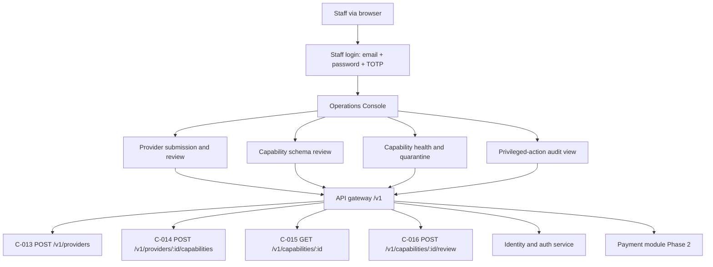

# Sabi: operations console

## Overview

The Operations Console is the staff web surface for the Phase 1 provider registration and review workflow of FEAT-012. It is a browser application, separate from the mobile client and from the channel surfaces, and it is never exposed to end users. Its Phase 1 scope is provider submission and review, capability schema review, health and quarantine, and the privileged-action audit view.

The console is the visible half of the operator workflow that [operations](operations.md) specifies. [Operations](operations.md) owns the workflow, the review criteria, the operator roles, and the audit rules; this document owns the surface those roles work in, the states each view presents, and the contract endpoint behind each action. Where the two disagree, [operations](operations.md) wins on workflow and this document wins on surface behavior.

This document does not restate the review criteria in [operations](operations.md), the entity fields in [schema](schema.md), or the contract request and response bodies in `CONTRACTS.md`. It references them.

## Scope and phasing

Phase 1 delivers one staff-facing web console covering the four Phase 1 surfaces named in the "Operations Console surface scope" table in [operations](operations.md). Provider submissions are captured staff-side through the console in Phase 1, so no provider-facing authentication surface is required before provider volume exists. A provider-facing self-service portal and the case-queue and reconciliation views are Phase 2, on the same C-013 to C-016 API introduced for Phase 1.

| Phase | Console surface | Serves |
|---|---|---|
| Phase 1 | Provider submission and review (staff-captured) | FEAT-012 |
| Phase 1 | Capability schema-version review | FEAT-012 |
| Phase 1 | Capability health and quarantine | FEAT-012 |
| Phase 1 | Privileged-action audit view | FEAT-012, NFR-028 |
| Phase 2 | Provider self-service portal (provider-facing) | FEAT-012, FEAT-020 |
| Phase 2 | Payment case queues (failed, reversed, refunded, disputed) | FEAT-009 |
| Phase 2 | Reconciliation and exception views | FEAT-006, FEAT-009 |
| Phase 3 | Third-party verification request handling and abuse review | FEAT-017 |
| Phase 4 | Provider marketplace operations | FEAT-020 |

The phase split follows the capability table in [operations](operations.md) and the build order in [roadmap](roadmap.md). Phase 2 and later surfaces are a forward view in this document, marked as not Phase 1, so the API and the surface are not conflated at build time.

**Delivery shape decision (settled).** Phase 1 is one browser-based staff Operations Console. The provider-facing self-service portal is Phase 2. The mobile in-app console option is rejected: the console is not one of the nine mobile screens and is never exposed to end users, and [branding](branding.md) targets mobile devices only with no pointer, hover, or desktop targets. The API-only option is rejected for Phase 1: staff capture and review is the workflow FEAT-012 needs at launch, and a staff web surface is the smallest surface that carries it.

## Actors and roles

The console serves the operator roles defined in [operations](operations.md). Phase 1 uses the provider review analyst and the administrator; the remaining roles are defined now and become active as their workflows arrive.

| Role | Phase active | Can see in the console | Can do in the console |
|---|---|---|---|
| Provider review analyst | Phase 1 | Provider submissions, capability records and schemas, health results, provider contacts | Create and edit a provider submission and a capability submission, review a schema version, approve, reject, quarantine, deregister |
| Administrator | Phase 1 | All console surfaces and role assignments | Grant and revoke operator roles, configure review policy |
| Compliance and privacy officer | Phase 1 (audit view) | Privileged-action audit log, consent and data subject records, access logs | Review audit entries, export or correct data under a valid request |
| Support operations agent | Phase 2 | Cases, payment status history, receipt records for the affected payment | Open, assign, and resolve cases; initiate a refund within the limit |
| Reconciliation officer | Phase 2 | Payment records, rail and agency statements, exception reports | Match and reconcile items, raise an exception case |

A role sees only the surfaces its workflow needs, per the least-privilege control in [operations](operations.md). Approval-gated actions, such as activating a capability that claims a service another provider already holds, are routed to the second approver named in [operations](operations.md).

## Staff authentication

This is an interface requirement, not a frozen contract. Staff authentication is a dedicated web login using email, password, and a time-based one-time password (TOTP), under multi-factor authentication. It is a new staff-auth surface, distinct from the end-user passkey flow in FEAT-001 and from the C-001 to C-008 account contracts.

| Aspect | Requirement |
|---|---|
| Credentials | Email identifier, password, and TOTP second factor |
| Assurance | MFA required for every operator role (NFR-020 in [nfr](nfr.md)) |
| Session | A distinct operator session, separate from any end-user session; HttpOnly, Secure, SameSite cookie with absolute and idle timeout (NFR-026 in [nfr](nfr.md)) |
| Separation | No impersonation: an operator never holds an end-user session and never sees user credentials, per [operations](operations.md) |
| Authorisation | Every action is role-scoped and purpose-bound; there are no shared operator accounts |
| Audit | Authentication, authorisation, and every privileged action are logged tamper-evidently (NFR-028 in [nfr](nfr.md)) |
| Recovery | A lost second factor is re-enrolled through the administrator role, not by an operator self-service path |

Assumption: the staff-auth endpoints are new and are not yet numbered in `CONTRACTS.md`. They are stated here as interface requirements so the build team can raise them as contracts before implementation. This document does not freeze their request or response shapes.

## Phase 1 views

Each view below states its purpose, the states it presents, the permitted role, the actions it offers, and the contract endpoint each action uses. Endpoints C-013 to C-016 are the provider registry surface defined in `CONTRACTS.md` and specified for FEAT-012 in [features](features.md). An action marked "new endpoint" needs a contract before build.

### Provider submission and review (staff-captured)

**Purpose.** Capture a provider and its capability on the provider's behalf, then review the submission against the criteria in [operations](operations.md) and record a decision. Submission is staff-side in Phase 1; the provider does not log in.

**States presented.**

| State | Meaning | Source field |
|---|---|---|
| `pending` | Submitted, not yet reviewed | `Provider.status`, `Capability.status` |
| `active` | Approved and discoverable | `Provider.status`, `Capability.status` |
| `suspended` | Provider held | `Provider.status` |
| `deregistered` | Provider removed from offering | `Provider.status` |
| `withdrawn` | Capability removed from offering | `Capability.status` |

**Permitted role.** Provider review analyst. An activation that claims a service another provider already holds requires the second approver named in [operations](operations.md).

**Actions and endpoints.**

| Action | Endpoint | Notes |
|---|---|---|
| Create a provider submission | C-013 `POST /v1/providers` | Returns a `Provider` with status `pending` |
| Create a capability submission | C-014 `POST /v1/providers/{providerId}/capabilities` | Returns a `Capability` with status `pending` |
| Read a capability and its health status | C-015 `GET /v1/capabilities/{capabilityId}` | Internal services use the same contract without the review surface |
| Record a review decision | C-016 `POST /v1/capabilities/{capabilityId}/review` | Decision `approve`, `reject`, `quarantine`, or `deregister`, with reason |
| Read the review history | Read of `CapabilityReview` in [schema](schema.md) | Queryable decision record, not audit-only; no new endpoint in Phase 1 |

A rejected submission states the reason from [operations](operations.md) and can be corrected and resubmitted on the same view. Activation records the reviewer, the decision, and the schema version in the audit log.

### Capability schema-version review

**Purpose.** Review a changed input schema before it replaces the active version, so a compatible change is adopted and an incompatible change is rejected until reviewed, per FEAT-012.

**States presented.** The active schema version, the submitted schema version, and the review outcome (`approve` or `reject`). The previous version stays active while the new version is under review, so an in-flight task is not broken.

**Permitted role.** Provider review analyst.

**Actions and endpoints.**

| Action | Endpoint | Notes |
|---|---|---|
| Read the current schema version | C-015 `GET /v1/capabilities/{capabilityId}` | `schemaVersion` field |
| Submit a changed capability version | C-014 `POST /v1/providers/{providerId}/capabilities` | A new version of the same capability |
| Approve or reject the version | C-016 `POST /v1/capabilities/{capabilityId}/review` | `schemaVersion` on the request must match, or the call returns 409 |
| View the schema against the client component catalogue | C-015 plus the catalogue read | A component outside the catalogue is rejected, per [features](features.md) |

### Capability health and quarantine

**Purpose.** Show the latest health result for each capability and let an analyst withdraw an unhealthy or forged capability from discovery, per FEAT-012.

**States presented.**

| State | Meaning | Source field |
|---|---|---|
| `healthy` | Latest health check passed | `Capability.healthStatus` |
| `degraded` | Latest health check is failing but the capability is not withdrawn | `Capability.healthStatus` |
| `unavailable` | Failing health checks; withdrawn from discovery | `Capability.healthStatus` |
| `quarantined` | A forged or missing result; removed from discovery and under review | `Capability.status` |

**Permitted role.** Provider review analyst. Repeated failures open a provider operations case and notify the provider contact, per [operations](operations.md).

**Actions and endpoints.**

| Action | Endpoint | Notes |
|---|---|---|
| Read health status | C-015 `GET /v1/capabilities/{capabilityId}` | `healthStatus` field |
| Quarantine a capability | C-016 `POST /v1/capabilities/{capabilityId}/review` | Decision `quarantine`; removes it from discovery |
| Restore after a fix | C-016 `POST /v1/capabilities/{capabilityId}/review` | Decision `approve` on a fixed capability |
| Move to deregistration | C-016 `POST /v1/capabilities/{capabilityId}/review` | Decision `deregister` |
| Trigger a health re-check | New endpoint, or the scheduled health-check job in [architecture](architecture.md) | Phase 1 relies on the scheduled check; a manual re-check is a candidate for a later phase |

Existing payment cases continue in the case workflow when a capability is quarantined; the decision and its evidence are recorded in the audit log.

### Privileged-action audit view

**Purpose.** Let the compliance and privacy officer review privileged actions and close a finding, and confirm that every action in the operator surfaces has a matching audit entry, per the audit review in [operations](operations.md) and NFR-028 in [nfr](nfr.md).

**States presented.** The audit timeline (actor, role, target, action, reason, timestamp), the alert state for high-risk actions (role grant, break-glass access, capability quarantine, refund above the limit, bulk data export), and the finding state for a review (open or closed).

**Permitted role.** Compliance and privacy officer for review and export; administrator for role grants and break-glass approval, per [operations](operations.md).

**Actions and endpoints.**

| Action | Endpoint | Notes |
|---|---|---|
| Read the audit log | New endpoint, read-only over the tamper-evident log | The log is append-only and retained under the data lifecycle in [nfr](nfr.md) |
| Filter by actor, role, target, or action | New endpoint, query parameters on the audit read | Supports the weekly and monthly reviews in [operations](operations.md) |
| Close a finding | New endpoint, records the reviewer and the resolution | A finding that finds an unlogged action blocks further privileged action by that role |
| Export an audit extract | New endpoint, gated to the compliance role | A bulk export is itself a privileged action and is logged |

The audit view reads the audit log; it never writes to it. No action in this view can edit or delete a log entry.

## Surface map

Every Phase 1 view reaches the backend through the API gateway and the C-013 to C-016 endpoints. The payment module node is shown because the audit view reads payment-module audit entries once Phase 2 is live; no Phase 1 console action writes to the payment module.

## Hosting and deployment

This is a settled position, not an open question.

| Aspect | Position |
|---|---|
| Placement | Served from the primary region behind the API gateway, consistent with the stateless-components-behind-the-gateway scaling in [architecture](architecture.md) |
| Deployable | A stateless deployable; session and role state live in the identity and auth service and the cache, not in the console process |
| Residency | Primary region in Nigeria, subject to the residency rule in [nfr](nfr.md) and the backup region rule in [architecture](architecture.md) |
| Access control | MFA and role gating at the gateway and in the identity and auth service (NFR-020 in [nfr](nfr.md)) |
| Isolation | The console shares the gateway contract with the mobile client and the channel gateways, and adds no separate backend |
| Logging | Every console action is logged tamper-evidently (NFR-028 in [nfr](nfr.md)) |

The console is a component in [architecture](architecture.md), the "Operations Console", whose Phase 1 surface covers provider review and the audit view. [Architecture](architecture.md) owns the component graph; this document owns the surface behavior without restating the component graph.

## Relationship to the mobile screens

The console is not a screen of the mobile product and is not one of the nine screens in [screens](screens.md). It does not appear in the screen inventory, the navigation map, or a `screens/` spec, and it is never exposed to an end user. Users reach operations only through the user surfaces named in [operations](operations.md): the [Case screen](screens/08-case.md), the receipt dispute action on [Receipt Detail](screens/07-receipt-detail.md), and the reachable support channels. The console is excluded from the nine mobile screens by design.

**Design-system coverage.** The Phase 1 console is covered by the [Desktop and Staff Console Token Set](branding.md#desktop-and-staff-console-token-set) in [branding](branding.md). The console inherits the brand colour, type, spacing, radius, elevation, and component grammar, and adds only the tokens a data-dense desktop layout needs: the console breakpoints and `content-max` and `shell-min` layout tokens, the desktop density tokens, the data-table tokens, the form-control additions, the desktop interaction states, and the sidebar and navigation tokens. The console reads as Sabi, not a generic admin panel. The set states a deliberate desktop `control-height` exception to the 44px touch minimum, documented against the Accessibility target in [branding](branding.md); touch paths stay at 44px. This document does not restate the token values, it references them. The mobile device targets in [branding](branding.md) remain mobile-only and are not the console's targets.

## Phase 2 additions, not Phase 1

The following surfaces are a forward view only. They are not Phase 1 scope and are not built against the C-013 to C-016 API in Phase 1.

**Provider self-service portal (Phase 2).** A provider-facing login and submission surface on the same C-013 to C-016 API, so a provider registers and manages its own capabilities. It needs a provider-auth surface, distinct from the staff-auth surface above, and arrives when provider volume justifies it, per the delivery-shape decision above.

**Payment case queues (Phase 2).** Queues for failed, reversed, refunded, and disputed payments, matching the case state machine in [operations](operations.md), on the payment module API that arrives with FEAT-009. The user sees the [Case screen](screens/08-case.md); the operator sees the queue and the actions behind it.

**Reconciliation and exception views (Phase 2).** Settlement matching and exception reporting for the reconciliation officer, on the payment loop and the federal payment flow in [operations](operations.md).

**Third-party verification and marketplace operations (Phase 3 and Phase 4).** Verification request handling and abuse review (FEAT-017), and provider marketplace billing and placement (FEAT-020), per the phase table in [operations](operations.md).

## Assumptions

| # | Assumption | Risk if false |
|---|---|---|
| OC-A1 | Staff capture of provider submissions is sufficient for Phase 1 provider volume | Provider onboarding is slower than expected and the self-service portal moves into Phase 1 |
| OC-A2 | The C-013 to C-016 endpoints cover every Phase 1 console action | A Phase 1 action needs a new contract before build, such as the audit read and the manual health re-check |
| OC-A3 | The staff-auth endpoints can be added without changing the end-user account contracts | The staff and end-user auth surfaces become coupled and the separation in this document weakens |
| OC-A4 | The console is built against the Desktop and Staff Console Token Set in [branding](branding.md), so no ad-hoc desktop styling is needed | The console drifts from the brand, or a token not in the sanctioned set is needed and the set is revised before it ships |

## Verification

| Check | Method | When |
|---|---|---|
| Phase 1 views reachable and role-gated | Access review against the operator roles in [operations](operations.md) | Quarterly |
| Every console action uses a frozen contract | Contract conformance against C-013 to C-016 and the staff-auth contracts | Each release |
| No end-user exposure | Confirm the console host and routes are unreachable from the mobile client and channels | Pre-launch, then each release |
| Staff and end-user sessions separate | Session-isolation test, including no impersonation | Pre-launch, annually |
| Every privileged console action audited | Audit-log completeness check | Monthly |
| Provider review decisions complete | Audit of submissions against the review criteria | Monthly |
| Capability health and quarantine current | Health-check report and quarantine log | Weekly |
| Console served from the primary region behind the gateway | Deployment-region and topology check | Each release |
| Desktop token conformance | Confirm the console's implemented tokens match the Desktop and Staff Console Token Set in [branding](branding.md), including the documented `control-height` exception | Pre-launch, then each release |
