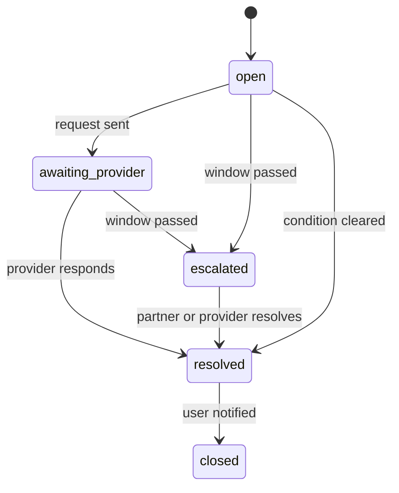

# Sabi: operations

## Overview

Sabi runs a hybrid support model: self-serve first, assisted support as the fallback. End users resolve most issues from the assistant, the Case screen, and status content, and reach an assisted queue for failed payments, reversals, and receipt disputes. Provider review, reconciliation, and compliance work are operator functions performed in the Operations Console, a staff and provider surface that is separate from the mobile client.

Assisted support runs 07:00 to 21:00 West Africa Time (WAT), seven days a week, with an on-call rotation for payment incidents outside those hours. Provider onboarding, reconciliation, and audit review run on business days. Accounts and channels serve users continuously.

Four roles are accountable for operations. The support operations lead owns the assisted queue and the case service windows. The provider operations lead owns registration review and capability health. The reconciliation officer owns settlement matching and exception reporting. The compliance and privacy officer owns audit review and data subject handling. The stakeholder personas in [user-personas](user-personas.md) name the needs these roles serve.

Out of scope for support: custom development for providers, state and local government payments beyond the federal scope in [overview](overview.md), cash collection, and financial advice. Sabi does not custody balances, so support cannot recover funds from an internal wallet.

This document owns the operational workflows. Feature scope and priority are owned by [features](features.md); phase timing by [roadmap](roadmap.md); reliability targets by [nfr](nfr.md); the data model by [schema](schema.md); and the user-facing case journey by [user-flow](user-flow.md) and the [Case screen](screens/08-case.md).

## Roadmap scope

Phase 1 has no money movement, so operations in Phase 1 is limited to what provider registration (FEAT-012) needs: operator roles, access control, and the provider review workflow. Payment case management, reconciliation, and receipt dispute operations begin when their features ship.

| Operations capability | Serves | Phase | Notes |
|---|---|---|---|
| Provider registration and capability review | FEAT-012 | Phase 1 | Activates a provider without a release |
| Capability schema-version review | FEAT-012 | Phase 1 | Adopts compatible changes and rejects incompatible ones until reviewed |
| Capability health monitoring and quarantine | FEAT-012 | Phase 1 | Withdraws unhealthy or forged results from discovery |
| Provider deregistration handling | FEAT-012 | Phase 1 | Stops offering a capability without stranding an in-flight payment |
| Operator roles, MFA, and privileged-action audit | FEAT-012 | Phase 1 | Constrains the Phase 1 operator actions |
| Payment case management | FEAT-009 | Phase 2 | Failed, reversed, refunded, and disputed payments |
| Reconciliation operations | FEAT-006, FEAT-009 | Phase 2 | Rail, agency, and internal records |
| Receipt dispute cases | FEAT-008 | Phase 2 | A stored receipt that does not reconcile, or is missing |
| Third-party receipt verification operations | FEAT-017 | Phase 3 | Verification requests and abuse handling |
| Provider marketplace operations | FEAT-020 | Phase 4 | Billing and placement for provider capabilities |

The Operations Console is phased with these capabilities. In Phase 1 its surface is provider review, capability health, and the privileged-action audit view. The case queues and reconciliation views described in [architecture](architecture.md) arrive with the payment loop in Phase 2, and are not Phase 1 scope.

## Support model and service windows

| Tier | Who it serves | Channel | First response | Resolution target | Escalation |
|---|---|---|---|---|---|
| Self-serve | All users | App, USSD, WhatsApp, SMS | Immediate | Not applicable | Assisted support |
| Assisted user support | All users with a payment or receipt issue | In-app Case contact, WhatsApp, SMS, callback | 4 business hours | Per case type below | Support operations lead |
| Provider operations | Registered providers | Provider portal and email | 1 business day | 5 business days | Provider operations lead |
| Compliance and data requests | Users and regulators | Recorded request | 72 hours to acknowledge | 30 days to complete | Compliance and privacy officer |

The case service windows below are the documented complaint and refund timelines required by NFR-044 in [nfr](nfr.md). They apply while a case is in `awaiting_provider`.

| Case type | Service window | On breach |
|---|---|---|
| `failed_no_delivery` | 3 business days | Escalate to the payment partner |
| `refund` | 5 business days | Escalate to the payment partner and notify the user |
| `disputed` | 7 business days | Escalate to the payment partner and the provider |
| `receipt_missing` | 2 business days | Re-query the receipt source, then escalate |

Self-serve first: coverage requests, payment status, receipt retrieval, refund tracking, and case status are available without an operator before a ticket is opened. A user reaches assisted support only when the self-serve path cannot resolve the issue, or when a case needs an operator action.

## Operator roles and access control

| Role | Can view | Can change | Approval required for |
|---|---|---|---|
| Provider review analyst | Submitted capabilities, schemas, health results, provider contacts | Capability review state and the approve or reject decision | Activating a capability that claims a service another provider already holds |
| Support operations agent | Cases, payment status history, receipt records, and contact details for the affected payment only | Open, assign, and resolve cases; initiate a refund within the set limit; issue a corrected receipt | A refund above the set limit; an account suspension |
| Reconciliation officer | Payment records, rail and agency statements, exception reports | Match and reconcile items; raise an exception case | Writing off an unreconciled item |
| Compliance and privacy officer | Audit log, consent and data subject records, access logs | Export, correct, or erase personal data under a valid request; suspend an account for compliance reasons | A bulk data export; an erasure under statutory hold |
| Administrator | All operator surfaces and role assignments | Grant and revoke operator roles; configure review policy | Granting an administrator role; break-glass access |

Controls:

- **MFA.** Every operator role requires multi-factor authentication (NFR-020 in [nfr](nfr.md)); a passkey alone is not sufficient for an operator session.
- **Least privilege.** Operator access is role-scoped and granted for a stated purpose. There are no shared operator accounts.
- **No impersonation.** Support does not act as a user and never sees credentials. It acts on the case and the payment record. Account recovery and identity changes stay with the account owner through the identity flow.
- **Audit trail.** Every privileged action records the actor, role, target, action, reason, and timestamp in the tamper-evident audit log (NFR-028 in [nfr](nfr.md)). The log is append-only and retained under the data lifecycle in [nfr](nfr.md).
- **Break-glass.** Emergency access is time-boxed, requires a second operator approver, and is reviewed within one business day.

## Provider onboarding and capability review

This is the Phase 1 workflow for FEAT-012. A provider publishes a discoverable capability, and Sabi reviews it before activation.

**Submission.** A provider submits a capability description with its service, collecting body, required inputs, input schema, amount source, result contract, and operational contact. The record maps to the `Provider` and `Capability` entities in [schema](schema.md).

**Review criteria:**

| Criterion | What is checked | Rejected when |
|---|---|---|
| Provider identity and ownership | Legal name, collecting body, operational contact, and the authority to collect the service | Authority is not established, or two providers claim the same service without a resolution |
| Capability description | What it collects, required inputs, amount source, result contract, and category | The description is incomplete, or the service falls outside the scope in [overview](overview.md) |
| Input schema and version | The declared input schema and its version, against the client component catalogue | The schema is missing or invalid, or it requires a component outside the catalogue |
| Amount handling | The amount source (`fixed`, `user_entered`, or `provider_query`) and, where fixed, the amount and currency | The amount source is absent, or a fixed amount is not stated in minor units |
| Result contract | The success, failure, and receipt fields the agent collects | The result cannot be validated or cannot yield a receipt |
| Data handling | The personal data the provider receives and its stated handling | The provider cannot meet the data rules in [nfr](nfr.md) |
| Government collection | For a federal service, the regularised collection channel and whether any deduction is taken | A point-of-collection deduction is proposed, or the channel is not the regularised one |

**Approval and activation.** A provider review analyst reviews the submission and activates the capability only after approval. A rejected submission states the reason and can be corrected and resubmitted. Activation makes the capability discoverable (FEAT-012); routing a live payment to it becomes available with the payment loop in Phase 2, per [roadmap](roadmap.md). A capability outside the client component catalogue is never offered to users. Activation records the reviewer, the decision, and the schema version in the audit log.

**Schema-version review.** A provider that changes its input schema submits the new version. A compatible change is reviewed and adopted; an incompatible change is rejected until reviewed (FEAT-012). The previous version stays active until the new one is approved, so an in-flight task is not broken. A schema change follows the same review criteria as a new capability.

**Health-check monitoring.** The capability registry runs scheduled health checks and records the result on `Capability.healthStatus` in [schema](schema.md). A capability that fails health checks is marked unavailable and withdrawn from discovery (FEAT-012). Repeated failures open a provider operations case and notify the provider contact.

**Quarantine.** A capability that returns a forged or missing result is quarantined and a review is opened (FEAT-012). Quarantine removes it from discovery and stops new payments; existing payment cases continue in the case workflow. The review either restores the capability after a fix or moves it to deregistration. The decision and its evidence are recorded in the audit log.

**Deregistration.** A provider may deregister, or Sabi may deregister a provider that fails review. A deregistration requested while a payment is in flight lets the in-flight payment complete or refund and then stops offering the capability (FEAT-012). Deregistration does not remove provider and capability records; they are retained under the data lifecycle in [nfr](nfr.md) for reconciliation and audit.

## Payment case management

This workflow arrives with FEAT-009 in Phase 2, when payments are live. Each case maps to the `PaymentCase` entity in [schema](schema.md), and each state change writes a payment event and can trigger a notification on the user's preferred channel.

### Case types

| Type | Opened when | Primary owner | First action |
|---|---|---|---|
| `failed_no_delivery` | A payment is debited but the service is not delivered | Support operations | Confirm rail and biller state, then open a refund |
| `disputed` | A user or a biller disputes a payment or a receipt | Support operations | Preserve the receipt and payment events, then reconcile |
| `refund` | A refund is required or has been initiated | Support operations | Track the refund to rail or biller acknowledgement |
| `receipt_missing` | A payment succeeded but no official receipt is stored | Support operations | Re-query the receipt source, then escalate |

### Case state machine

| State | Meaning | Enters when |
|---|---|---|
| `open` | The case is created and not yet with a provider | A condition is detected or a user reports one |
| `awaiting_provider` | A request is with the provider, rail, or receipt source | The first action sends a request |
| `escalated` | The case exceeds its service window or needs the payment partner | A window passes, or the rail and biller disagree |
| `resolved` | The condition has cleared | A provider responds, a refund settles, or a receipt arrives |
| `closed` | The case record is complete and the user is notified | Resolution is communicated |

**Assignment.** Each case carries an `assigneeRole` and is assigned to the role that owns the first action. It moves to another role on escalation. The queue is keyed by transaction reference, so a case matches the payment and the receipt by reference. This is Emeka's stated need in [user-personas](user-personas.md).

**Escalation to the payment partner.** A case escalates when it exceeds its service window, when the rail and the biller disagree, or when the partner does not acknowledge a refund. Escalation routes the case to the payment partner's dispute channel with the payment reference, the receipt, and the payment event timeline, and marks it `escalated`. The user is told the case is escalated and given the expected window.

**Duplicate-refund prevention.** A refund is keyed by the payment reference and the idempotency key. A second refund for the same reference is detected and blocked, in the case workflow and at the rail boundary (FEAT-009). The case records the blocked duplicate with its reason.

**Case tooling.** The queue, the timeline, refund initiation, and duplicate detection are operator capabilities in the Operations Console. The user sees the [Case screen](screens/08-case.md), which shows the true state, the timeline, and a contact route; the operator sees the queue and the actions behind it.

## Payment operations

Payment operations execute the payment and fraud rules across the case workflow. Fraud thresholds and card-rail rules are not restated here; the risk and compliance requirements are in [risk-log](risk-log.md) and [nfr](nfr.md).

| Trigger | Detection | Action | Owner | Window |
|---|---|---|---|---|
| Failed payment | Rail webhook or the payment state machine | Confirm state, open `failed_no_delivery`, and refund if the user was debited | Support operations | Within the `failed_no_delivery` window |
| Refund request | User dispute or automatic detection | Open a `refund` case and initiate with the rail or biller | Support operations | Within the `refund` window |
| Dispute or chargeback | Card processor notice | Suspend the disputed payment, gather the receipt and the signed mandate, and submit evidence | Support operations then reconciliation | Before the processor deadline |
| Suspected fraud | Risk rule or transaction monitoring (NFR-041 in [nfr](nfr.md)) | Hold the payment feature, request verification, and preserve the audit trail | Compliance | Immediate hold |
| Chargeback rate breach | Monthly processor report | Review the rules and hold new card payments if the rate breaches | Compliance | Monthly review |

**Appeals.** A user whose payment feature is held or whose account is suspended can request a review. The compliance and privacy officer re-checks the decision against the audit trail and the payment records, and either restores access or records the reason for the hold. A restored account is recorded in the audit log.

## Third-party receipt verification operations

This workflow arrives with FEAT-017 in Phase 3. An authorised third party, such as a business that must verify a payment, submits a receipt or reference, and the receipt service verifies it against the source of truth and returns verified or unverified.

- **Source unavailable.** The result is returned as pending, never a false negative (FEAT-017). The check is retried and the requester is told it is pending.
- **Revoked or unknown receipt.** The result is unverified with a reason. A disputed verification is recorded without altering the original receipt, following the receipt rules in FEAT-008.
- **Abuse.** Bulk checks require authentication and are throttled (FEAT-017). A requester that exceeds the rate is blocked and reviewed.
- **Audit.** Every verification request and result is logged (NFR-028 in [nfr](nfr.md)) and retained with the receipt record under the data lifecycle in [nfr](nfr.md).

## Reconciliation operations

This workflow arrives with the payment loop and federal payments in Phase 2. Daily reconciliation matches the payment records store against the licensed rail statement and, for federal payments, against the agency collection record and the Federal Treasury e-Receipt source. It serves Bola's need in [user-personas](user-personas.md).

- Matched items are closed. An unmatched or mismatched item opens an exception case: a debit with no delivery, a payment the agency does not show, or a receipt with no matching payment. The mismatch rules in FEAT-006 and FEAT-009 apply.
- Federal collection is checked for no point-of-collection deduction and for arrival in the designated treasury account. A deduction or a wrong account is raised as an exception and escalated.
- Exception reporting by reference is produced for agency revenue officers, and carries no personal data beyond the payment reference.
- Writing off an unreconciled item requires the reconciliation officer and a second approver, and is recorded in the audit log.

## Privileged-action and audit-log review

The audit log covers authentication, authorisation, and privileged actions, and is tamper-evident (NFR-028 in [nfr](nfr.md)).

- Automated alerts fire on high-risk actions, including a role grant, break-glass access, a capability quarantine, a refund above the limit, and a bulk data export.
- A weekly review of privileged actions is performed by the compliance and privacy officer. A monthly completeness check confirms that every action in the operator surfaces has a matching audit entry.
- Reviewed actions include role grants and revocations, break-glass access, capability activation and quarantine, deregistration, refunds above the limit, account suspension, bulk data export, and erasure.
- A review that finds an unlogged privileged action blocks further privileged action by that role until the gap is corrected and the action is reconstructed in the log.

## Operations Console surface scope

The Operations Console is the staff and provider surface described in [architecture](architecture.md). It is not a screen of the mobile product and is not one of the nine screens in [screens](screens.md); it does not appear in the screen inventory or the navigation map. Users reach operations only through the existing user surfaces: the [Case screen](screens/08-case.md), the receipt dispute action on [Receipt Detail](screens/07-receipt-detail.md), and the reachable support channels. The console is never exposed to end users.

| Phase | Console surface |
|---|---|
| Phase 1 | Provider submission and review, capability schema review, health and quarantine views, and the privileged-action audit view |
| Phase 2 | Payment case queues for failed payments, reversals, refunds, and receipt disputes, plus reconciliation and exception views |
| Phase 3 | Third-party verification request handling and abuse review |
| Phase 4 | Provider marketplace operations |

Access to the console requires MFA and an assigned role, and every action is logged (NFR-020 and NFR-028 in [nfr](nfr.md)).

## Incident and escalation

| Severity | Definition | Response | Communication |
|---|---|---|---|
| SEV-1 | Payment execution is unavailable, or payment or personal data is at risk | Page on-call immediately | Status page and stakeholder update within 30 minutes |
| SEV-2 | A feature is degraded, such as a channel or a provider capability | On-call within 1 hour | Status page if user-visible |
| SEV-3 | A minor issue with a workaround | Next business day | Case update |

- The degradation table in [nfr](nfr.md) states the expected user-visible behavior for each dependency failure, and incidents are handled to those behaviors.
- **On-call.** A primary and secondary rotation covers payments and the channels. The payment module carries the highest availability target, NFR-011 in [nfr](nfr.md).
- **Postmortem.** Blameless, within 3 business days for SEV-1 and 5 for SEV-2, with action items tracked to completion.

## Runbooks

| Runbook | Covers | Owner |
|---|---|---|
| Capability review | Reviewing a provider submission from receipt to decision | Provider operations |
| Capability quarantine | Removing a forged or failing capability from discovery | Provider operations |
| Provider deregistration | Stopping a capability safely, including in-flight payments | Provider operations |
| Payment case triage | Opening, assigning, and resolving a failed or disputed payment | Support operations |
| Refund escalation | Escalating an unresolved refund to the payment partner | Support operations |
| Daily reconciliation | Matching rail, agency, and internal records and raising exceptions | Reconciliation |
| Audit review | Reviewing privileged actions and closing a finding | Compliance |
| Data subject request | Handling an access, correction, export, or deletion request | Compliance |

## Verification

| Check | Method | When |
|---|---|---|
| Provider review decisions complete | Audit of submissions against the review criteria | Monthly |
| Capability health and quarantine current | Health-check report and quarantine log | Weekly |
| Case service windows met | Case queue report by type and window | Weekly |
| Duplicate refunds blocked | Reconcile refund requests against executed refunds | Monthly |
| Reconciliation exceptions closed | Exception report and write-off log | Monthly |
| Privileged actions audited | Audit-log completeness check | Monthly |
| Operator access current | Access review of role grants | Quarterly |
| Runbooks current | Dry-run the top three runbooks | Quarterly |
