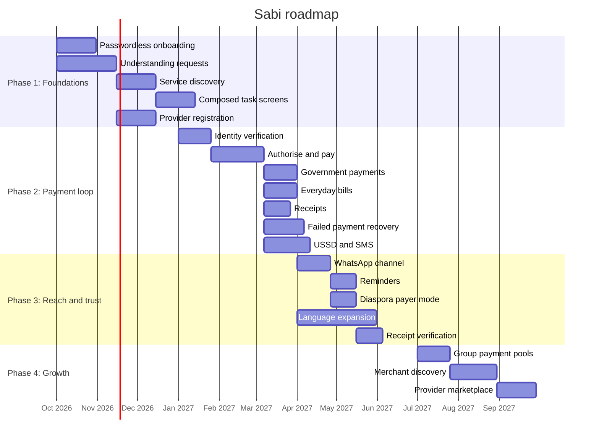

# Sabi: roadmap

## Vision

Sabi gives every Nigerian a single conversation for paying government obligations and everyday bills, and a receipt they can trust, whether they carry a smartphone or not.

## Timeline overview

## Phase 1: Foundations

**Goal:** Let a user onboard without a password, ask for what they need, and get a correct answer about an obligation or bill before any money moves.
**Target:** Q4 2026.

**Key outcomes:**
- A user can create an account and return to it without a phone number or password.
- A request in English or Pidgin resolves to a real agency, levy, or biller.
- A provider can register a payable service without a new release.
- The wedge is testable without a payments licence, which de-risks the build before money is involved.

**Features delivered:**

| Feature ID | Feature | Why it matters |
|---|---|---|
| FEAT-001 | Passwordless onboarding and identity | Removes the phone-number wall and the password |
| FEAT-003 | Understanding requests in English and Pidgin | The core of the assistant |
| FEAT-004 | Service, agency, and biller discovery | Answers the question of where and how much to pay |
| FEAT-011 | Composed task screens | New providers work without an app update |
| FEAT-012 | Provider registration | Makes adding agencies and billers a registration, not a release |

## Phase 2: The payment loop

**Goal:** Let a user pay a federal obligation or an everyday bill and hold a verified receipt, with a clear path when a payment fails.
**Target:** Q1 2027.

**Key outcomes:**
- A user can authorise and complete a payment and receive the official government receipt where one applies.
- A user on a feature phone can pay by USSD and receive the result by SMS.
- A failed or debited payment is detected and refunded without the user chasing it.

**Features delivered:**

| Feature ID | Feature | Why it matters |
|---|---|---|
| FEAT-002 | Identity verification for regulated payments | Verifies the user before regulated payments |
| FEAT-005 | Payment authorization and execution | Moves money through a licensed rail |
| FEAT-006 | Federal government payment flows | Serves the e-receipt mandate and its payers |
| FEAT-007 | Everyday bill flows | Creates weekly habit for traders and riders |
| FEAT-008 | Verifiable receipt capture and retrieval | The proof users and businesses need |
| FEAT-009 | Payment status, failure, and refund handling | Addresses the trust problem the market complains about |
| FEAT-010 | USSD and SMS channel | Reaches feature-phone users without data |

This phase cannot ship without the licensed payment partner, the regularised government collection channel, and the identity verification path. These are tracked as dependencies in [overview](overview.md).

## Phase 3: Reach and trust

**Goal:** Meet users on WhatsApp, remind them before deadlines, serve the diaspora, and support the major Nigerian languages.
**Target:** Q2 2027.

**Key outcomes:**
- A user can complete the same jobs inside WhatsApp.
- A business user is reminded before a deadline and can pay in one step.
- A diaspora payer can settle a Nigerian bill and share the receipt.
- A user can work in Hausa, Yoruba, or Igbo once each language clears its quality bar.

**Features delivered:**

| Feature ID | Feature | Why it matters |
|---|---|---|
| FEAT-013 | WhatsApp channel | Reaches users where they already work |
| FEAT-014 | Obligation calendar and reminders | Prevents penalties for businesses |
| FEAT-015 | Diaspora payer mode | Serves a paying segment abroad |
| FEAT-016 | Language expansion | Makes the assistant usable beyond English |
| FEAT-017 | Receipt verification for third parties | Lets businesses verify a receipt without a call |

## Phase 4: Growth

**Goal:** Extend from individual payments to shared obligations, merchant payment, and a provider marketplace.
**Target:** Q3 2027.

**Key outcomes:**
- Groups can collect contributions toward one obligation.
- Users can find and pay a trusted merchant through Sabi.
- Providers can offer and be paid for a capability inside Sabi.

**Features delivered:**

| Feature ID | Feature | Why it matters |
|---|---|---|
| FEAT-018 | Shared and group payment pools | Matches how communities already pay together |
| FEAT-019 | Merchant and storefront discovery | Connects commerce to the payment loop |
| FEAT-020 | Provider marketplace and monetization | Turns reach into revenue for providers and Sabi |

## What's next

- FEAT-021: Community and social layer. Deferred until payment behaviour creates a reason to gather. Sabi does not compete with WhatsApp for general chat.
- FEAT-022: Savings and credit products. Deferred until an appropriate licence is held, since lending is barred under the payment licence Sabi can access today.
