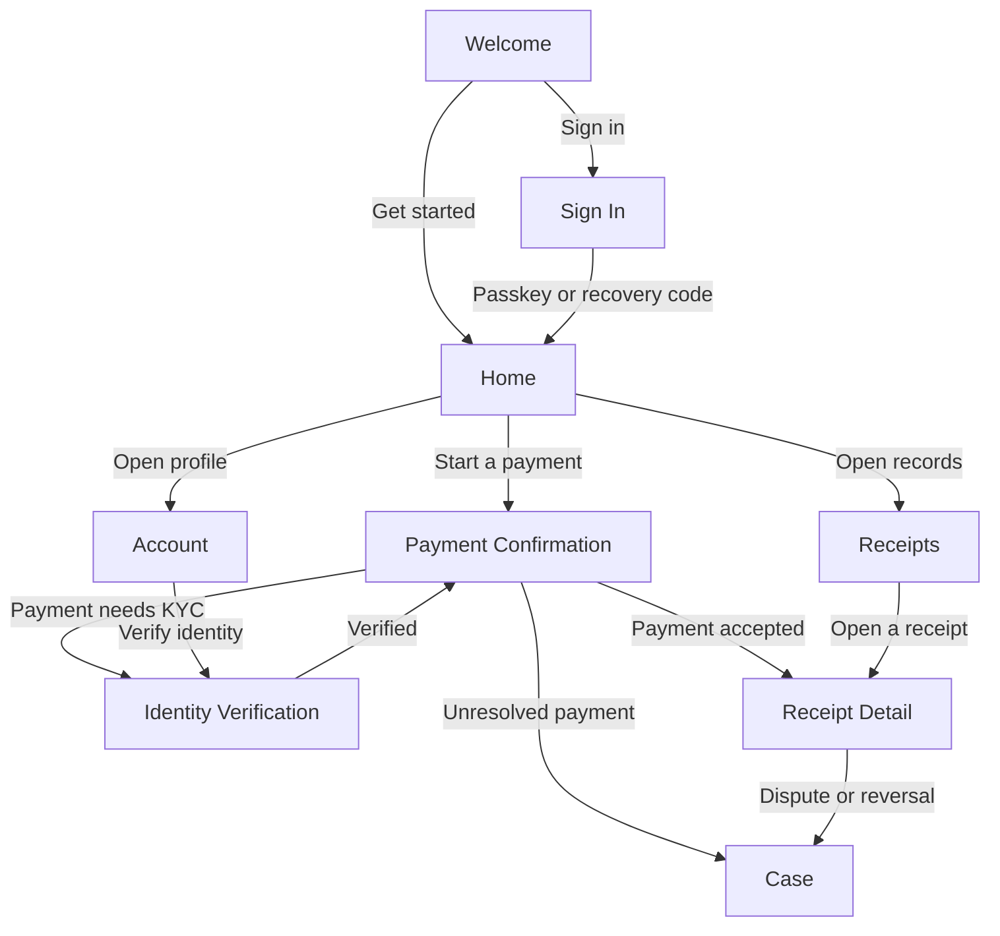

# Sabi: screens

## Screen Inventory

| # | Screen Name | File | Route / Path | Platform | Related Features |
|---|---|---|---|---|---|
| 1 | Welcome | [01-welcome](screens/01-welcome.md) | `/welcome` | Mobile | FEAT-001 |
| 2 | Sign In | [02-sign-in](screens/02-sign-in.md) | `/sign-in` | Mobile | FEAT-001 |
| 3 | Home | [03-home](screens/03-home.md) | `/home` | Mobile | FEAT-003, FEAT-004, FEAT-011 |
| 4 | Payment Confirmation | [04-payment-confirmation](screens/04-payment-confirmation.md) | `/pay/:intentId` | Mobile | FEAT-005, FEAT-011 |
| 5 | Identity Verification | [05-identity-verification](screens/05-identity-verification.md) | `/account/verify` | Mobile | FEAT-002 |
| 6 | Receipts | [06-receipts](screens/06-receipts.md) | `/receipts` | Mobile | FEAT-008 |
| 7 | Receipt Detail | [07-receipt-detail](screens/07-receipt-detail.md) | `/receipts/:receiptId` | Mobile | FEAT-006, FEAT-008, FEAT-017 |
| 8 | Case | [08-case](screens/08-case.md) | `/cases/:caseId` | Mobile | FEAT-009 |
| 9 | Account | [09-account](screens/09-account.md) | `/account` | Mobile | FEAT-001, FEAT-002, FEAT-015 |

USSD prompts and WhatsApp messages are channel surfaces owned by their providers; they are content, not screens of the mobile product, and are documented in [user-flow](user-flow.md).

The Operations Console is a separate staff web surface, specified in [operations-console](operations-console.md). It is not an inventory entry of the mobile product: it has no route here, is not in the navigation map below, and is never exposed to an end user.

## Navigation Map

## Shared / Common Components

### Navigation Shell
Used on: Home, Receipts, Account
- Mobile: BottomNavigationBar with 3 tabs: Home, Receipts, Account.
- Hidden on Welcome, Sign In, Payment Confirmation, Identity Verification, and Case, which are task-first surfaces.

### Composed Task Surface
Used on: Home, Payment Confirmation
- The agent-composed container. It renders only components in this catalogue, never a raw message.
- Consumes a declarative UI stream: surface creation, components, and data model; the client renders natively with brand tokens.
- Refuses an unknown component and renders a text-and-form fallback for the same task, so the task stays completable.
- Discards a malformed UI message without losing the task; renders placeholders for partial data.

### Confirmation Summary
Used on: Payment Confirmation, Case
- Shows the amount, payee, charges, and reference in one block.
- The amount uses the `h2` type token; the payee and charges are `text-secondary`.

### Service Result Row
Used on: Home
- A discovery result: collecting body, obligation, known amount or "amount confirmed at payment", and a select action.
- Selected background uses `primary-300`.

### Status Pill
Used on: Home, Receipts, Receipt Detail, Case
- States: pending, settled, failed, awaiting receipt, unverified.
- Always an icon plus a text label with the semantic colour; never colour alone.

### Receipt Card
Used on: Home, Receipts
- Reference, payee, amount, date, and receipt kind; opens Receipt Detail.

### Empty State
Used on: Home, Receipts
- Centred illustration, a headline, a contextual subtitle, and one call-to-action.
- Uses the shared empty-state illustration.

### Error State
Used on: all screens that fetch data
- Centred illustration, "Something went wrong", a brief description, and a "Try again" primary button.

### Offline Banner
Used on: all screens
- Persistent banner stating what is queued and its sync status. No payment can be authorised while offline.

### Success Toast
Used on: Payment Confirmation, Receipt Detail
- Confirms a stored receipt or token. It never carries the only success signal; the Status Pill also carries it.

### Amount Entry
Used on: Payment Confirmation
- Bottom sheet for a variable amount; validates against the biller's range.

### Provider Picker
Used on: Home
- Bottom sheet listing candidate collecting bodies when a request matches more than one.

## Shared Assets

| Asset | Subject | Where it appears | Style pointer |
|---|---|---|---|
| Brand mark | A speech bubble whose tail tears like a receipt edge | Splash, About, store listing | Brand Mark Direction |
| App icon | The mark inside its rounded-square container | Device home screen, store listing | Brand Mark Direction |
| Splash graphic | The mark on the warm off-white surface | App launch | Brand Mark Direction |
| Empty-state illustration | A receipt book with no pages written yet | Empty states on Home and Receipts | Illustration Direction |
| Offline illustration | A signal broken between a phone and a service | Offline state | Illustration Direction |
| Success animation | A receipt tear forming a settled tick | Payment Confirmation success; Receipt Detail arrival | Motion Direction |
| Pending animation | A gentle loop while a payment reconciles | Payment Confirmation and Case pending | Motion Direction |
| Error animation | A receipt edge re-tearing and settling flat | Payment failure states | Motion Direction |
