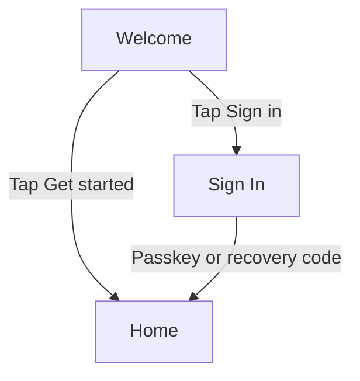
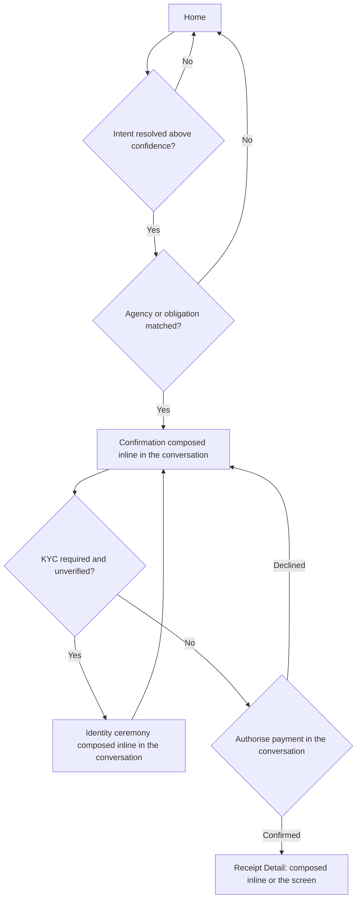
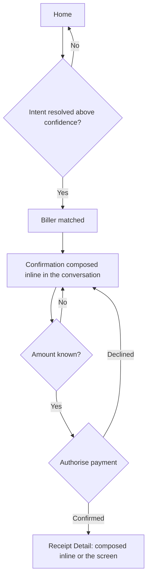
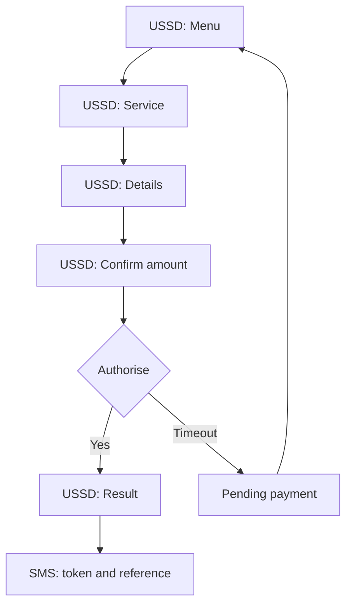
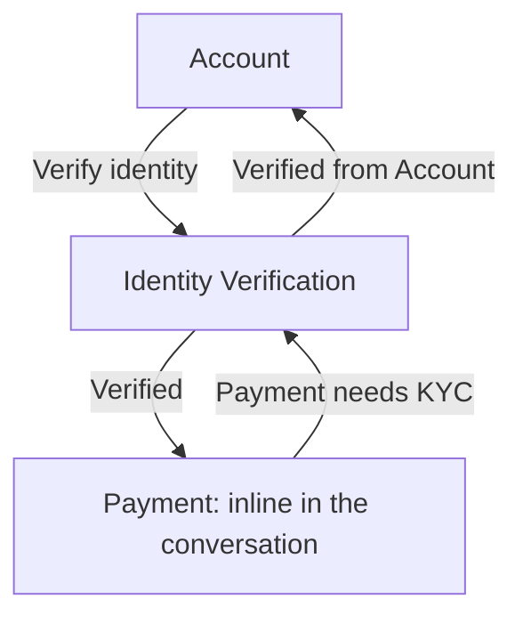
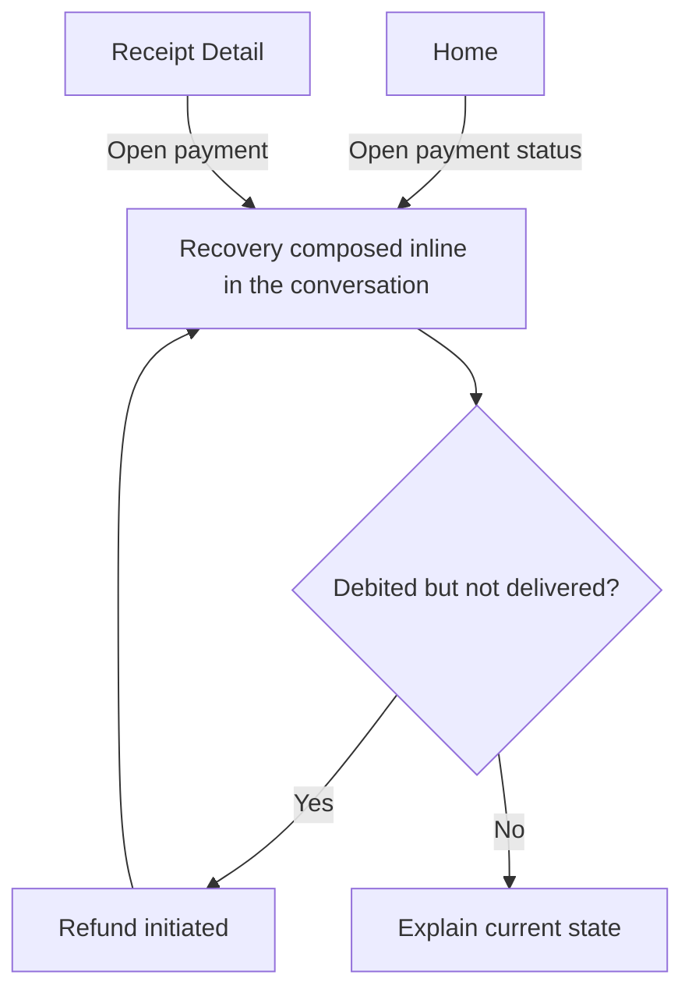
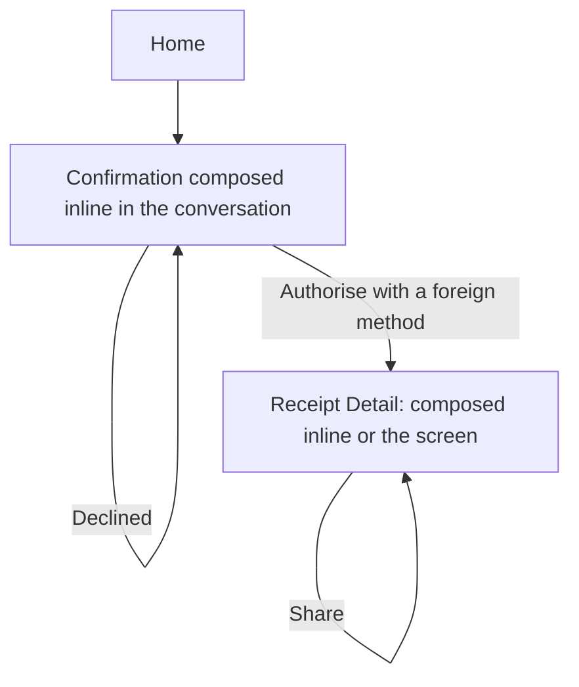
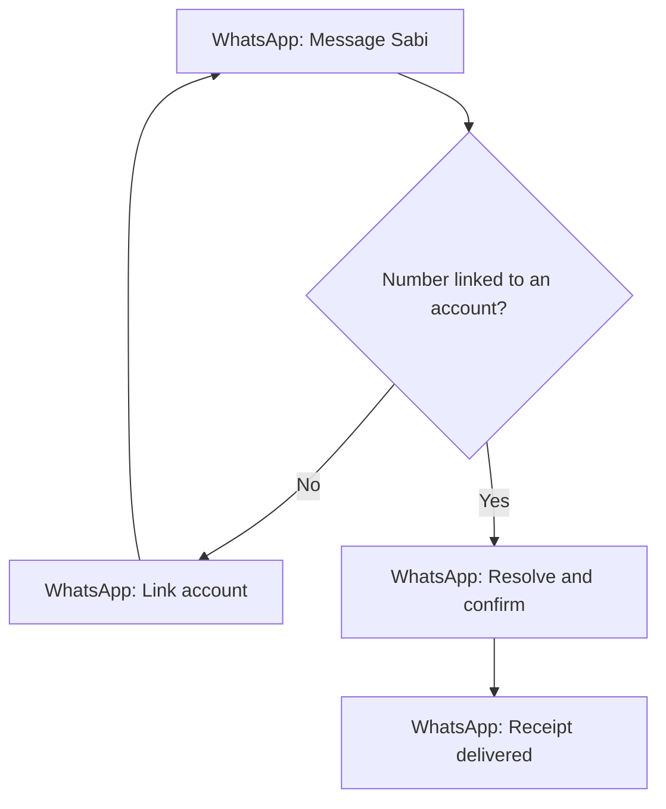
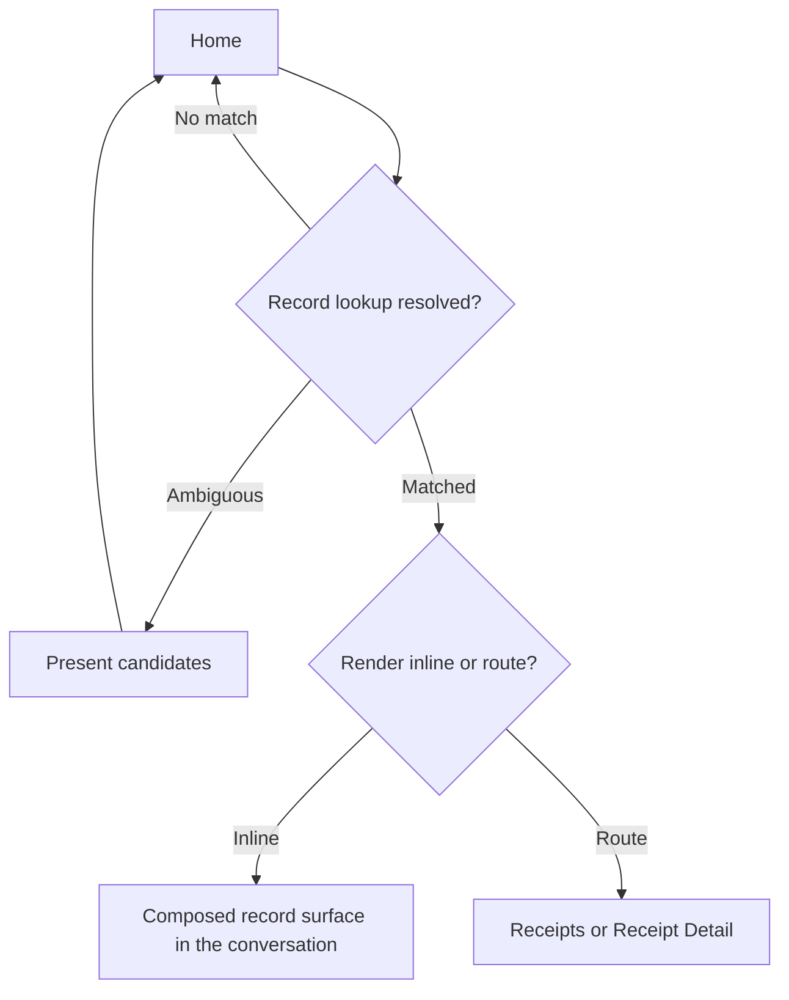

# Sabi: user flow

## Flow Inventory

| # | Flow Name | Persona | Entry Point | Outcome | Related Features |
|---|---|---|---|---|---|
| 1 | Create an account and start | Ngozi (new user) | App install or first open | Account with a passkey; Home usable | FEAT-001 |
| 2 | Ask Sabi to pay a government obligation | Ngozi | Home | Obligation paid; FTeR stored and openable | FEAT-003, FEAT-004, FEAT-005, FEAT-006, FEAT-008, FEAT-011 |
| 3 | Pay an everyday bill | Ngozi | Home | Token or confirmation returned; receipt stored | FEAT-003, FEAT-005, FEAT-007, FEAT-008, FEAT-011 |
| 4 | Pay by USSD with no data | Musa | Dial the Sabi USSD code | Payment completed; token and reference by SMS | FEAT-010, FEAT-005, FEAT-007, FEAT-008 |
| 5 | Verify identity for a regulated payment | Ifeoma | A payment that requires KYC, or Account | Account verified; held payment resumes | FEAT-002 |
| 6 | Recover a failed or reversed payment | Ngozi | Payment notification or payment status | Refund initiated or a Case opened with a reference and timeline | FEAT-009 |
| 7 | Pay from abroad and share proof | Tunde | Home | Biller settled in Naira; receipt shared with beneficiary | FEAT-015, FEAT-005, FEAT-008 |
| 8 | Reach Sabi on WhatsApp | Ngozi | WhatsApp message to the Sabi number | Payment completed and receipt delivered in the chat | FEAT-013 |
| 9 | Look up a record in the conversation | Ifeoma | Home | The record is shown inline as a composed surface, or the user is routed to the existing screen | FEAT-003, FEAT-008, FEAT-023, FEAT-011 |

These flows serve P0 and reach features. Provider registration (FEAT-012) and third-party receipt verification (FEAT-017) are deliberately not charted here: their actors are providers and businesses, and they depend on [operations](operations.md).

## Canonical Vocabulary

Names set here are canonical and are formalized by the screens document.

**Mobile screens:** Welcome, Sign In, Home, Receipts, Receipt Detail, Obligations, Account.
**Route-backed composed surfaces:** Identity Verification, Case.
**Overlays (never diagram nodes):** Provider picker sheet, Amount entry sheet, Recovery code sheet, Re-authorisation sheet, Success toast, Clarification (an inline state of Home).

The conversation on Home is the primary and complete path: payment authorisation and mandate signing, variable amount entry, the identity ceremony, and case or failure recovery each compose their surface inline in the conversation and complete there, and record lookups resolve there too. Discovery results, the provider picker, confirmations, verification, record viewing, and recovery are composed by the agent from the published Sabi catalog and render inside Home. The screens that remain are those a non-conversation surface still reaches: Receipts, Receipt Detail, and Account from the navigation shell, Identity Verification from Account, and Case from Receipt Detail. Adding a provider therefore adds no route. USSD and WhatsApp surfaces are owned by their channel providers; their prompts and messages are content, not screens of the mobile product.

Across every flow the motion character is calm and purposeful ([branding](branding.md)): a payment confirmation lands with weight rather than celebration.

## Flow 1: Create an account and start

**Persona:** Ngozi (new user)
**Entry Point:** App install or first open
**Outcome:** An account with a passkey; Home usable for discovery

### Diagram

### Walkthrough

**Happy Path:**
1. User opens Sabi for the first time and lands on Welcome, which states the value in one line and offers "Get started" and "Sign in".
2. User taps "Get started". No phone number and no password are requested.
3. System checks whether the device supports passkeys.
4. Passkey support is present: system runs the passkey ceremony and enrols a credential.
5. System creates the account and shows the recovery code once in the Recovery code sheet, with a single "I have saved it" acknowledgement.
6. System navigates to Home. Discovery is usable immediately.

**Alternate Path A — No passkey support:**
- At step 3, if the device has no passkey support, the system falls back to recovery code plus optional email verification and states the reduced security before creating the account. Return to step 5.

**Alternate Path B — Returning user signs in:**
- From Welcome the user taps "Sign in". On Sign In the system runs the passkey ceremony. If the only passkey is lost, the user enters the saved recovery code and is prompted to enrol a new passkey. On success, navigate to Home.

**Alternate Path C — Recovery code not saved:**
- At step 5, if the user acknowledges without saving, the account is still created, but the system warns that losing the passkey makes the account unrecoverable. The warning repeats once on the next sign-in.

**Alternate Path D — Offline:**
- At step 3, if the device is offline, account creation is queued locally and completes when connectivity returns. The user reaches Home in a read-only state with discovery unavailable and an offline banner.

**Alternate Path E — Channel link later:**
- A USSD or WhatsApp number may be linked from Account. If the number already belongs to another account, the link is rejected and the account owner is notified. A channel link never creates a second account.

### States & Overlays Referenced

| Screen or Overlay | States |
|---|---|
| Welcome | Default, Creating account, Passkey unsupported, Offline, Error |
| Sign In | Default, Passkey prompt, Recovery code entry, Error |
| Home | First-run, Loading, Loaded, Offline |
| Recovery code sheet (overlay on Welcome) | Default, Acknowledged |
| Success toast (overlay) | — |

## Flow 2: Ask Sabi to pay a government obligation

**Persona:** Ngozi
**Entry Point:** Home
**Outcome:** The obligation is paid and the FTeR is stored and openable

### Diagram

### Walkthrough

**Happy Path:**
1. On Home, the user types a request in Pidgin, for example "I wan pay my land use charge".
2. System resolves the request to a structured intent with target candidates and a confidence value. Above threshold, it proceeds.
3. Home renders a composed discovery surface listing the matching agency or obligation with the collecting body and any known amount.
4. User selects the target.
5. Home composes the confirmation surface inline in the conversation with the amount, payer reference, charges, and payee, and takes authorisation and mandate signing there, so the payment is completed without leaving the conversation.
6. If the obligation requires a reference number the user does not have, Home explains how to obtain it and does not start a payment.
7. User authorises. System signs a mandate bound to the amount, the payee, and the user.
8. System executes the payment through the licensed rail and returns a transaction reference.
9. On success, system retrieves the FTeR from the central platform and stores it against the obligation.
10. The receipt is shown either as a composed surface inline in the conversation or on Receipt Detail, whichever the user chooses, with the FTeR identifier marked verified and a success toast.

**Alternate Path A — Low confidence:**
- At step 2, if confidence is below threshold, Sabi keeps the conversation context and asks a follow-up question in Home with the closest candidates, authored by the model in natural language. The user's answer is added to what Sabi already knows, and Sabi asks again while the request stays unclear, up to three clarifying questions in one conversation. If it still cannot resolve after the third, it gives the Unresolved reply, authored by the model: it states plainly why it cannot proceed, offers catalogue search and human support, invites the user to continue, and records the request for coverage. The reply and the questions before it are category-neutral, and none of them substitutes a different specific service for the one the user named: a request for "Airtel airtime" is never answered by offering "MTN airtime", and "Ikeja Electric" is never answered by offering "Eko Electric". A neutral disambiguating question ("which network?", "which provider?") or catalogue search is given instead, so the user chooses rather than being handed a payee. No payment starts.

**Alternate Path B — Multiple matches:**
- At step 3, a Provider picker sheet lists the top candidates and requires a choice before the confirmation surface is composed.

**Alternate Path C — Service not covered:**
- At step 3, if the catalogue has no match, Sabi gives a non-resolving reply, authored by the model, in the register that there is no resolution for that service right now: it states the honest reason, offers catalogue search and human support, invites the user to name the collecting body or another detail, and records the query for coverage planning. It never fabricates a result and never claims the service is unsupported. It also never substitutes a different specific service for the one the user named: a query for "Airtel airtime" is never answered by offering "MTN airtime", and "Ikeja Electric" is never answered by offering "Eko Electric".

**Alternate Path D — Payment declined at the rail:**
- At step 8, system shows the failure reason and next step in the composed confirmation surface inline in the conversation. The payment is not marked complete.

**Alternate Path E — Unknown outcome or timeout:**
- At step 8, on a rail timeout with unknown outcome, system marks the payment pending, does not retry immediately, and reconciles before informing the user. An unresolved payment opens a recovery surface, composed inline in the conversation (see Flow 6).

**Alternate Path F — Succeeded but no FTeR yet:**
- At step 9, if the FTeR has not arrived, the receipt is shown as pending and keeps checking, inline in the conversation or on Receipt Detail. The receipt appears when the central platform returns it. Receipt coverage target is 100% at launch (success metrics).

**Alternate Path G — Switched agency collection account:**
- Before payment, system detects that the agency collection account has changed and routes to the current channel.

**Alternate Path H — Cash-only counter:**
- If the only collection route is a cash-only counter, system tells the user, since Sabi cannot pay cash.

**Alternate Path I — Duplicate authorisation:**
- A double tap or retried session executes once and returns the same reference, enforced by an idempotency key.

**Alternate Path J — Offline:**
- At step 1, if the device is offline, the request is queued and discovery is unavailable with an offline banner. Authorisation cannot be given offline.

**Alternate Path K — Greeting or non-command message:**
- At step 1, if the user sends a greeting or other non-command message (for example, "Hello"), Sabi gives a conversational reply, authored by the model: it states what it can do and invites a request, in the sanctioned tone and without assuming any service category. The message is not treated as a low-confidence intent or a coverage miss, and is not recorded for coverage.

### States & Overlays Referenced

| Screen or Overlay | States |
|---|---|
| Home | Default, Composing, Discovery results, Confirmation inline, Verifying inline, Recovering inline, Clarifying, Unresolved, Conversational, No resolution, Awaiting FTeR, Offline, Error |
| Identity ceremony (inline on Home) | Default, Checking, Verified, No match, Provider unavailable |
| Receipt Detail | Awaiting receipt, Verified, Unverified, Error |
| Provider picker sheet (overlay on Home) | Default |
| Amount entry sheet (overlay on Home) | Default, Validation error |
| Success toast (overlay) | — |

## Flow 3: Pay an everyday bill

**Persona:** Ngozi
**Entry Point:** Home
**Outcome:** A token or service confirmation is returned and the receipt is stored

### Diagram

### Walkthrough

**Happy Path:**
1. On Home the user states the purchase, for example "buy five thousand MTN" or "buy electricity".
2. System resolves the adapter or biller and the product category.
3. Home composes the confirmation surface inline in the conversation with the biller, the recipient identifier, the amount, and any charge.
4. If the amount is variable, the Amount entry sheet collects it over the composed surface in the conversation.
5. User authorises; system signs a mandate and executes the payment through the licensed rail.
6. System returns and stores the token or confirmation with the receipt.
7. The receipt is shown either as a composed surface inline or on Receipt Detail, whichever the user chooses, with a success toast.

**Alternate Path A — Wrong identifier before execution:**
- At step 3, a wrong meter or phone number may be corrected or cancelled only before execution. After execution the payment is not reversible by editing.

**Alternate Path B — Biller offline:**
- At step 5, if the biller is offline, payment is prevented and the user is told to try later. No debit occurs.

**Alternate Path C — Token not returned:**
- At step 6, if the payment succeeds but the token does not return, system holds the transaction open and retries retrieval before marking it complete.

**Alternate Path D — Biller rejects after rail debit:**
- At step 6, if the biller rejects after the rail debit, the refund path in Flow 6 is triggered.

**Alternate Path E — Offline:**
- At step 1, if offline, the request is queued and the payment cannot be authorised.

### States & Overlays Referenced

| Screen or Overlay | States |
|---|---|
| Home | Default, Composing, Discovering, Confirmation inline, Offline |
| Receipt Detail | Token returned, Awaiting token, Verified, Error |
| Amount entry sheet (overlay on Home) | Default, Validation error |
| Success toast (overlay) | — |

## Flow 4: Pay by USSD with no data

**Persona:** Musa
**Entry Point:** Dial the Sabi USSD code
**Outcome:** Payment completed; token and reference delivered by SMS

### Diagram

### Walkthrough

**Happy Path:**
1. User dials the Sabi USSD code. The session opens on a short USSD: Menu in his chosen language.
2. User selects a service on USSD: Service, kept to the highest-frequency payments.
3. User enters the recipient details on USSD: Details (meter or phone number).
4. User sees the amount and the USSD session charge on USSD: Confirm amount.
5. User authorises within the session.
6. System executes the payment and shows the result on USSD: Result.
7. System delivers the token and the transaction reference by SMS.

**Alternate Path A — Timeout before authorisation:**
- At step 5, if the session times out before authorisation, no payment is executed. The airtime charge for the session still applies; the next session starts fresh.

**Alternate Path B — Timeout after authorisation:**
- At step 5, if the session times out after authorisation, the payment is marked pending and resumes in the next session rather than restarting.

**Alternate Path C — SMS delivery fails:**
- At step 7, if SMS delivery fails, the message is retained for retry and the status is shown on the next session.

**Alternate Path D — Session cost:**
- Sessions are capped and billed to airtime ([NCC USSD Determination 2025](https://www.ncc.gov.ng/sites/default/files/2025-04/USSD-DETERMINATION-2025.pdf)), so prompts are few and short (NFR-006). The user is told the charge applies per session, including a failed one.

### States & Overlays Referenced

| USSD or SMS Surface | States |
|---|---|
| USSD: Menu | Default, Timed out |
| USSD: Service | Default, Timed out |
| USSD: Details | Default, Validation error, Timed out |
| USSD: Confirm amount | Default, Timed out |
| USSD: Result | Success, Failure, Pending |
| SMS delivery | Sent, Retrying, Failed |

## Flow 5: Verify identity for a regulated payment

**Persona:** Ifeoma
**Entry Point:** A payment that requires KYC (composed inline on Home), or Account
**Outcome:** The account is verified and the held payment resumes

### Diagram

### Walkthrough

**Happy Path:**
1. A payment that requires KYC is held rather than failed; the user is told verification is needed.
2. System composes the verification surface inline in the conversation on Home, the primary path; the Identity Verification screen remains reachable from Account for a user who verifies outside a payment.
3. User provides their NIN, and their BVN where the payment rail requires it.
4. System checks the details against the national identity provider and stores a verification status on the account.
5. On a match, the held payment resumes in the same conversation without re-entering details.

**Alternate Path A — No match:**
- At step 4, if the check returns no match, the user sees a plain reason and may correct details once; a second failure routes to support.

**Alternate Path B — Provider unavailable:**
- At step 4, if the identity provider is unavailable, the verification is queued and the user is told it is pending. Discovery is not blocked.

**Alternate Path C — Already verified:**
- If the account is already verified, no repeat verification is requested for a later regulated payment.

**Alternate Path D — Fraud flag:**
- If a verified account is later flagged for fraud, payment features are suspended and the audit trail is preserved.

### States & Overlays Referenced

| Screen or Overlay | States |
|---|---|
| Identity Verification | Default, Checking, Verified, No match, Pending provider, Error |
| Payment inline in the conversation | Held for KYC, Resumed |
| Account | Unverified, Pending, Verified, Rejected, Suspended |

## Flow 6: Recover a failed or reversed payment

**Persona:** Ngozi
**Entry Point:** Payment notification, or payment status from Home or Receipt Detail
**Outcome:** A refund is initiated, or a Case is open with a reference and a timeline

### Diagram

### Walkthrough

**Happy Path:**
1. User opens a payment from Home, where the recovery surface is composed inline in the conversation, or from Receipt Detail, which opens Case.
2. Recovery shows the current state and the last update time.
3. System detects a debit without delivery.
4. System initiates a refund with the rail or the biller and opens a case keyed by reference.
5. System reports progress and a firm expected timeline, in the conversation and by notification on the user's preferred channel.

**Alternate Path A — Rail and biller disagree:**
- At step 3, if the rail reports success and the biller reports failure, system reconciles against both sources before refunding.

**Alternate Path B — Duplicate refund:**
- A second refund for the same reference is detected and blocked.

**Alternate Path C — Case exceeds the service window:**
- At step 5, if the biller does not respond within the stated window, the case escalates to the payment partner and the user is told.

**Alternate Path D — Offline:**
- If offline, recovery shows the last known state with an offline banner and no new actions.

### States & Overlays Referenced

| Screen or Overlay | States |
|---|---|
| Case | Pending, Reconciling, Refund initiated, Awaiting biller, Escalated, Resolved |
| Home | Loaded, Recovering inline, Offline |
| Receipt Detail | Loading, Loaded, Awaiting receipt, Verified, Unverified, Error |
| Notification | Queued, Delivered, Delayed |

## Flow 7: Pay from abroad and share proof

**Persona:** Tunde
**Entry Point:** Home
**Outcome:** The biller is settled in Naira and the receipt is available to sender and beneficiary

### Diagram

### Walkthrough

**Happy Path:**
1. User states the Nigerian obligation to settle from abroad.
2. System resolves the biller and composes the confirmation surface inline in the conversation with the amount, the FX rate, any fee, and the total in both currencies.
3. User authorises from a foreign card or transfer.
4. System settles the biller in Naira.
5. System stores the receipt and makes it available to the sender and the beneficiary, inline in the conversation or on Receipt Detail, whichever the user chooses.

**Alternate Path A — FX or settlement delay:**
- At step 4, if settlement is delayed, system shows the true status and the expected timing rather than a false success.

**Alternate Path B — Card declined:**
- At step 3, if the card is declined, system offers an alternative method without losing the obligation.

**Alternate Path C — Cross-border rules:**
- Application rules and any applicable tax are shown before authorisation.

### States & Overlays Referenced

| Screen or Overlay | States |
|---|---|
| Home | Default, Composing, Confirmation inline, Offline |
| Receipt Detail | Settled, Pending settlement, Share sheet open |

## Flow 8: Reach Sabi on WhatsApp

**Persona:** Ngozi
**Entry Point:** A WhatsApp message to the Sabi business number
**Outcome:** The payment is completed and the receipt is delivered in the chat

### Diagram

### Walkthrough

**Happy Path:**
1. User sends a payment request from a linked WhatsApp number.
2. Sabi resolves the intent, confirms the amount and payee in the chat, and takes authorisation.
3. System executes the payment using the same account and rails as the app.
4. System returns the receipt in the chat.

**Alternate Path A — Unlinked number:**
- If the number is not linked, linking is offered without requiring a new identity.

**Alternate Path B — Duplicate request across channels:**
- If the same request arrives over both the app and WhatsApp, system deduplicates by intent and reference and executes once.

**Alternate Path C — Channel provider outage:**
- If the WhatsApp provider is unavailable, inbound messages are queued and users are notified of a delay. Messages are delayed, never lost.

### States & Overlays Referenced

| Chat Surface | States |
|---|---|
| WhatsApp: Message Sabi | Default, Unlinked, Linked |
| WhatsApp: Link account | Default, Pending, Linked, Error |
| WhatsApp: Resolve and confirm | Resolving, Clarifying, Confirming, Authorising |
| WhatsApp: Receipt delivered | Delivered, Retrying, Failed |

## Flow 9: Look up a record in the conversation

**Persona:** Ifeoma
**Entry Point:** Home
**Outcome:** The record is rendered inline as a composed surface, or the user is routed to the existing screen; the choice is left to the user

### Diagram

### Walkthrough

**Happy Path:**
1. On Home the user asks about a record they hold: "show me the receipt for my December NEPA payment" or "did my Airtel top-up go through".
2. System resolves the request as a record lookup and grounds it in the user's own records (receipts, payments, and obligations), never in model recall.
3. On a single match, Home composes the record inline as a composed surface, showing that record's own fields: for a receipt, its reference, amount, payee, date, and verification state; for a payment status, its current state and last update.
4. The user may instead choose the existing screen (Receipts or Receipt Detail) to see the same record; neither route is the fallback for the other.
5. The user can act on the record from where it is shown: share or export a receipt, or open the related case.

**Alternate Path A: No matching record:**
- At step 3, if no record matches, Sabi says plainly that no matching record was found, composes no record surface, and does not fabricate one. It invites the user to refine the reference, the payee, or the date.

**Alternate Path B: Several matches:**
- At step 3, if the lookup matches several records, Home presents the candidates and the user chooses which to open, rather than guessing.

**Alternate Path C: Record raised mid-task:**
- If the user asks about a record while a payment task is open, the lookup is answered without abandoning the task; the open task keeps its place in the conversation.

**Alternate Path D: Record not the user's:**
- If the lookup names a reference on another account, nothing is disclosed and no record is returned for the mismatched reference.

**Alternate Path E: Offline:**
- If offline, cached records are shown where available, with an offline banner and no new actions.

### States & Overlays Referenced

| Screen or Overlay | States |
|---|---|
| Home | Default, Composing, Record lookup, Record rendered inline, No record found, Offline, Error |
| Receipts | Loading, Loaded, Empty, No results, Error |
| Receipt Detail | Loaded, Awaiting receipt, Verified, Unverified, Error |
| Share sheet (overlay on Home or Receipt Detail) | Default |

## Global Flows

### Authentication Gate
- Any screen opened through a deep link while unauthenticated redirects to Sign In, then returns to the originally requested screen.
- A session that expires while the user is on a screen shows the Re-authorisation sheet and does not lose the current screen state.

### Channel Identity Linking
- A USSD or WhatsApp number links to one account. A second number that conflicts with an existing account is rejected and the owner is notified.
- A link never creates a duplicate account, and no payment can be authorised from an unlinked channel.

### Error Recovery
- Any call that fails with a server error shows an inline error with a retry, and the user's input is preserved.
- An authentication failure triggers the Re-authorisation sheet; a permission failure shows a plain explanation.
- A network loss during data entry queues the action, shows an offline banner, and syncs when reconnected. The payment module deduplicates by idempotency key, so a replayed request never double-pays.
- An unknown payment outcome is held pending and reconciled, never retried blindly.

### Language and Fallback
- The response language is bound into the model context, so the model speaks the user's chosen language in its authored replies rather than rendering a prewritten localised string. Only static chrome (buttons, labels, and fixed in-app text) is prewritten for latency.
- Sabi falls back to English with a note rather than mis-resolving when a language is unavailable. Every channel honours the same preference.
